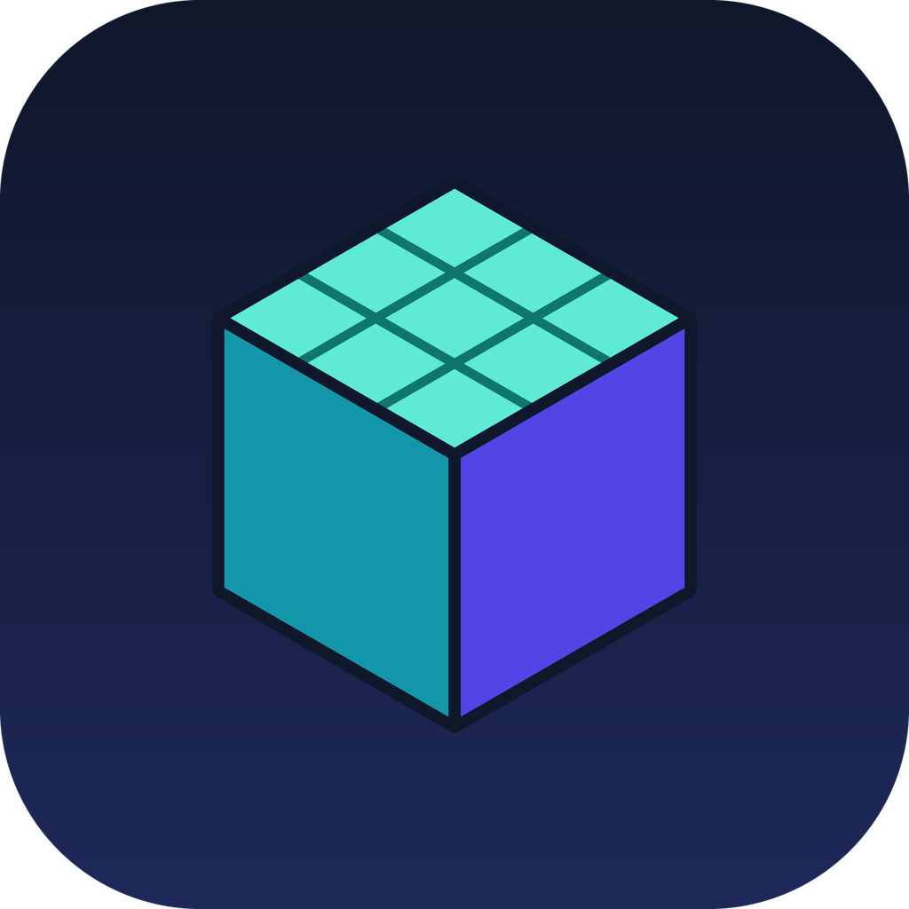

# VoxelGL

**Dil / Language**: **Türkçe**

Mobil Minecraft: Java Edition launcher'ları (PojavLauncher, ZalithLauncher, FCL) için geliştirilen özel bir OpenGL renderer eklentisidir. [MobileGlues](https://github.com/MobileGL-Dev/MobileGlues) projesinin çatalıdır (fork) ve GNU LGPL-2.1 lisansı altındadır.

> [!WARNING]
> Bu proje geliştirme aşamasındadır. Aşağıdaki hedeflerin hiçbiri henüz gerçek cihazlarda test edilip doğrulanmış değildir. Şu an yapılan değişiklikler yalnızca marka ve paketleme değişiklikleridir; renderer'ın kendisi MobileGlues 2.0.0 ile aynıdır.

## Amaç

Minecraft'ın mobil launcher'larda daha kararlı çalışması, FPS'in artması ve grafik kaynaklı hataların azalması.

## Hedefler (yol haritası)

| # | Hedef | Durum |
|---|-------|-------|
| 1 | FPS artışı, FPS düşüşlerinin azaltılması | Planlandı |
| 2 | Mojang ekranından sonra siyah ekran | Planlandı (önce log ve cihaz verisi toplanacak) |
| 3 | Yeni dünyada chunk'ların yüklenmemesi / geç yüklenmesi | Planlandı |
| 4 | OpenGL ES / Vulkan sürücü uyumluluğu | Planlandı |
| 5 | Shader çökmeleri ve görüntü bozulmaları | Planlandı |
| 6 | RAM kullanımı | Planlandı |
| 7 | GPU verimliliği | Planlandı |
| 8 | Doku yükleme hataları | Planlandı |
| 9 | Çökme önleme | Planlandı |
| 10 | Isınma ve uzun oyun kararlılığı | Planlandı |

Her özellik, desteklenmeyen cihazlarda kendiliğinden kapanacak şekilde (güvenli geri dönüş) ve mevcut launcher yapısını bozmadan eklenecektir.

## Depo yapısı

| Klasör | İçerik |
|--------|--------|
| `VoxelGL-core` | Renderer'ın C++ çekirdeği (`libmobileglues.so` olarak derlenir) |
| `VoxelGL-plugin` | Android eklenti uygulaması (Kotlin / Compose) |
| `VoxelGL-docs` | Dokümantasyon, uyumlu mod ve shader listeleri, cihaz raporları |

## Uyumluluk notu

Uygulamanın görünen adı ve simgesi değiştirildi, ancak launcher'ların eklentiyi tanıması için paket adı (`com.fcl.plugin.mobileglues`) ve kütüphane adı (`libmobileglues.so`) bilerek korundu. Bunları değiştirmek mevcut launcher'larda tanınmama riskine yol açar.

## Kaynak ve lisans

- Orijinal proje: MobileGlues (MobileGL-Dev), LGPL-2.1. Orijinal README'ler `upstream/` klasöründedir.
- Üçüncü taraf bileşenler: SPIRV-Cross, glslang, cJSON, FidelityFX-FSR, Perfetto, xxHash, flat_hash_map. Eklenti ayrıca Miuix, Jetpack Compose, AndroidX, kotlinx.coroutines ve Gson kullanır. Ayrıntılar `upstream/README_UPSTREAM.md` içindedir.
- Bu çatalın değişiklikleri de LGPL-2.1 altında yayımlanmalı ve `LICENSE` dosyaları korunmalıdır.
